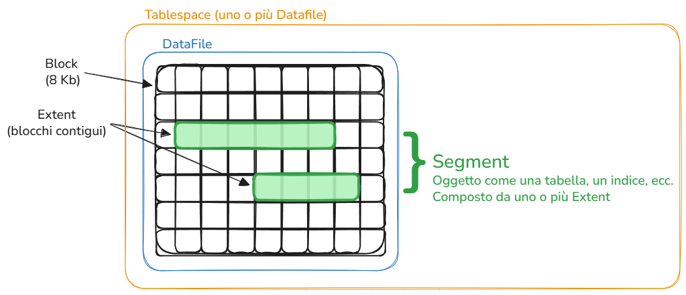

## Che cos'è?

Il piano dello storage con cui ragiona Oracle: tablespace, segment, extent e blocchi.

## A cosa serve?

Organizza i dati dentro i datafile, che sono il punto in cui si aggancia al piano fisico.

